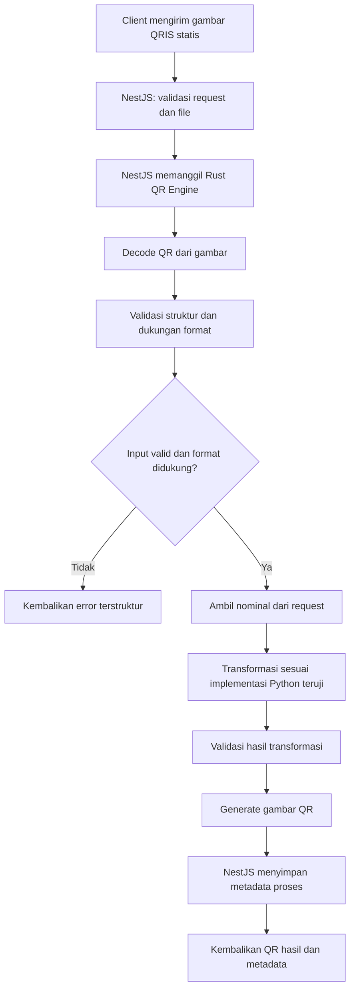

# KIRANA PAY — AI CODING AGENT BRIEF
## Backend MVP 0.1: Static QRIS → Amount-Specific QR Checkout

> **Tujuan dokumen:** menjadi konteks utama untuk AI coding agent agar implementasi konsisten, hemat token, tidak mengarang aturan QRIS, dan fokus menyelesaikan backend MVP terlebih dahulu.

---

## 0. Instruksi utama untuk coding agent

Kamu bertindak sebagai **senior backend engineer** untuk proyek Kirana Pay.

Sebelum menulis kode:
1. Periksa struktur repository dan file yang sudah ada.
2. Cari implementasi Python milik pengguna yang sebelumnya berhasil mengonversi QRIS statis menjadi QR dengan nominal. Jangan menimpa atau membuang implementasi tersebut.
3. Baca `README`, konfigurasi, test, dan dokumentasi yang tersedia.
4. Laporkan secara singkat apa yang sudah ada, apa yang belum ada, dan rencana perubahan.
5. Implementasikan secara bertahap. Jangan membuat seluruh sistem sekaligus.

**Jangan mengarang algoritma, format payload, aturan QRIS, field, checksum, atau perilaku provider.** Implementasi Python dan test vector yang diberikan pengguna adalah sumber kebenaran untuk perilaku transformasi yang sudah diuji. Jika kode Python atau test vector belum tersedia, siapkan struktur proyek, interface, validasi umum, dan test harness; lalu minta pengguna menyediakan implementasi/contoh input-output sebelum mengisi transformasi QRIS yang spesifik.

Jangan mengklaim QR hasil generasi valid untuk pembayaran nyata hanya karena gambar QR berhasil dibuat atau checksum lolos. Validitas harus diuji dengan aplikasi pembayaran/acquirer yang relevan dan alur yang diizinkan.

---

# 1. Konteks produk

**Nama produk:** Kirana Pay  
**Kategori:** Payment Automation SaaS  
**Tagline sementara:** Payments, Made Effortless.  
**Domain kandidat:** `kiranapay.co.id` (belum menjadi dependensi teknis).

Kirana Pay adalah platform otomatisasi pembayaran untuk merchant yang menggunakan akun dan QRIS merchant milik mereka sendiri.

Untuk MVP ini, fokus hanya pada kemampuan backend:

**Merchant mengunggah QRIS statis miliknya → memasukkan nominal → backend memproses QR → backend mengembalikan QR checkout yang dapat diuji.**

Kirana Pay bukan wallet dan tidak menerima atau menampung dana pelanggan. Dana pembayaran tetap mengalir ke akun merchant melalui infrastruktur penyedia/acquirer terkait. Backend Kirana Pay hanya menangani data QR, pembuatan hasil checkout, dan metadata proses.

Pengguna akhir produk nantinya terdiri dari:
- Developer / pemilik website: menggunakan API dan webhook.
- UMKM / penjual biasa: menggunakan dashboard dan payment link tanpa coding.

Namun, **dua tipe pengguna tersebut belum perlu dibuat pada MVP backend ini**. Bangun fondasi backend yang nantinya dapat digunakan keduanya.

---

# 2. Ruang lingkup MVP 0.1

## Termasuk

1. Backend API menggunakan NestJS + TypeScript.
2. QR Engine terpisah menggunakan Rust.
3. Upload gambar QRIS statis.
4. Decode/read QR dari gambar.
5. Validasi input dan struktur yang dapat diverifikasi.
6. Transformasi nominal berdasarkan implementasi Python milik pengguna yang sudah terbukti.
7. Generate gambar QR dari payload hasil transformasi.
8. Endpoint untuk melihat hasil proses dan mengunduh QR.
9. Error handling, logging, dan automated tests.
10. Dokumentasi API dan instruksi menjalankan proyek secara lokal.

## Tidak termasuk untuk sekarang

Jangan implementasikan kecuali diminta secara eksplisit:
- Frontend / dashboard Next.js.
- Android Companion dan notification listener.
- Pairing perangkat.
- Gmail API / OAuth / Pub/Sub.
- Integrasi GoBiz atau provider merchant lainnya.
- Payment verification dari notifikasi.
- Invoice lifecycle lengkap.
- Webhook ke website pelanggan.
- Payment link.
- Subscription, analytics, multi-provider routing.
- Wallet, saldo internal, atau penampungan dana.
- Sistem billing SaaS dan paket berlangganan.

Jangan membuat fitur tambahan hanya karena terlihat berguna. Fokus pada alur MVP.

---

# 3. Arsitektur yang dituju

Gunakan **monorepo** dengan komponen yang terpisah dan dapat di-deploy secara independen.

```text
kirana-pay/
├── apps/
│   └── api/                    # NestJS + TypeScript
├── services/
│   └── qr-engine/              # Rust service
├── packages/
│   └── contracts/              # Kontrak/API types jika memang diperlukan
├── docs/
│   ├── architecture.md
│   └── api.md
├── infrastructure/
│   └── docker/
├── docker-compose.yml
├── pnpm-workspace.yaml
├── package.json
└── README.md
```

### Komponen

**A. NestJS API**
- Menjadi pintu masuk API.
- Menerima upload gambar.
- Memvalidasi request.
- Mengatur proses QR.
- Memanggil Rust QR Engine melalui HTTP internal.
- Menyimpan metadata proses.
- Mengembalikan response yang konsisten.

**B. Rust QR Engine**
- Menjadi service khusus pemrosesan QR.
- Memisahkan parser, validator, transformer, generator, dan error.
- Tidak mengurus akun pengguna, database bisnis, atau dashboard.
- Menyediakan HTTP API internal menggunakan Axum.
- Tidak boleh mengandung aturan QRIS hasil tebakan.

**C. PostgreSQL**
- Menyimpan metadata QR dan riwayat proses seperlunya.
- Jangan menyimpan data sensitif yang tidak dibutuhkan.
- Untuk MVP, desain skema sederhana dan mudah dimigrasikan.

**D. Penyimpanan file**
- Buat abstraction/interface untuk penyimpanan gambar.
- Gunakan local storage hanya untuk development.
- Jangan mengunci desain agar tidak bisa dipindah ke object storage nantinya.
- Jangan menyimpan gambar upload secara permanen jika tidak diperlukan.

Komunikasi NestJS → Rust menggunakan HTTP internal dengan timeout, validasi schema, dan error mapping yang jelas. Jangan mengekspos endpoint internal QR Engine langsung ke internet.

---

# 4. Alur backend yang wajib dibuat



### Urutan kerja setiap request

1. Client mengirim gambar QR dan nominal.
2. NestJS memeriksa ukuran file, tipe file, request body, dan nominal.
3. NestJS meneruskan input ke QR Engine.
4. QR Engine membaca QR dari gambar.
5. QR Engine memvalidasi format dan memastikan format termasuk yang didukung.
6. QR Engine menjalankan transformasi dengan perilaku yang sama dengan implementasi Python teruji.
7. QR Engine membuat gambar QR dari payload hasil.
8. QR Engine mengembalikan hasil dan metadata teknis yang aman.
9. NestJS menyimpan metadata proses dan mengembalikan response ke client.

Jika QR tidak terbaca, format tidak didukung, nominal tidak valid, atau transformasi gagal, hentikan proses dan kembalikan error. Jangan menghasilkan QR pengganti atau menebak data yang hilang.

---

# 5. Kontrak API awal

Gunakan prefix `/v1`. Nama endpoint boleh disesuaikan jika ada alasan teknis yang kuat, tetapi dokumentasikan perubahannya.

## 5.1 Health check

`GET /health`

Contoh response:

```json
{
  "status": "ok",
  "service": "kirana-api"
}
```

Tambahkan health check internal untuk QR Engine. Jangan membocorkan environment variable, secret, atau detail infrastruktur.

## 5.2 Membuat QR checkout

`POST /v1/qr/convert`

Content type: `multipart/form-data`

Field:
- `file`: gambar QRIS statis milik merchant.
- `amount`: nominal integer dalam rupiah.

Contoh response sukses (kontrak ilustratif; sesuaikan implementasi):

```json
{
  "success": true,
  "data": {
    "id": "qr_job_id",
    "status": "generated",
    "amount": 150000,
    "currency": "IDR",
    "qrImage": {
      "mimeType": "image/png",
      "data": "BASE64_ENCODED_IMAGE"
    }
  }
}
```

Jangan mengembalikan payload pembayaran mentah ke log. Apabila payload memang diperlukan untuk debugging internal, redaksi bagian sensitif dan jangan tampilkan secara default.

## 5.3 Mengambil metadata hasil proses

`GET /v1/qr/:id`

Response hanya memuat metadata yang memang disimpan. Jangan mengarang status pembayaran; MVP ini hanya menghasilkan QR, bukan memverifikasi pembayaran.

## 5.4 Error response

Gunakan format konsisten:

```json
{
  "success": false,
  "error": {
    "code": "UNSUPPORTED_QR_FORMAT",
    "message": "QR format is not supported."
  }
}
```

Buat error code minimal untuk:
- `INVALID_FILE_TYPE`
- `FILE_TOO_LARGE`
- `QR_NOT_READABLE`
- `UNSUPPORTED_QR_FORMAT`
- `INVALID_AMOUNT`
- `QR_VALIDATION_FAILED`
- `TRANSFORMATION_FAILED`
- `QR_ENGINE_UNAVAILABLE`
- `INTERNAL_ERROR`

Jangan mengirim stack trace atau detail internal kepada client.

---

# 6. Aturan input dan keamanan

Terapkan validasi defensif:
- Terima hanya format gambar yang memang didukung, misalnya PNG/JPEG.
- Batasi ukuran upload dengan nilai konfigurasi yang masuk akal.
- Periksa MIME type dan signature file; jangan percaya nama file dari client.
- Tolak file kosong, rusak, atau gambar tanpa QR yang terbaca.
- Validasi nominal sebagai integer positif dalam batas konfigurasi.
- Hindari floating-point untuk nominal rupiah.
- Terapkan timeout saat memanggil Rust Engine.
- Batasi ukuran request dan cegah resource exhaustion.
- Jangan menyimpan API secret, OTP, password merchant, atau kredensial provider.
- Jangan meminta OTP atau password akun merchant.
- Jangan mencatat gambar QR lengkap atau payload mentah ke log produksi.
- Tambahkan rate limiting dasar pada endpoint publik.
- Gunakan konfigurasi melalui environment variables dan sediakan `.env.example` tanpa secret nyata.

Untuk MVP lokal, authentication boleh dibuat minimal atau menggunakan development API key. Namun jangan membuat endpoint sensitif terbuka tanpa perlindungan jika aplikasi dipasang ke internet. Dokumentasikan batasan auth MVP dengan jelas.

---

# 7. Desain internal Rust QR Engine

Struktur yang disarankan:

```text
services/qr-engine/
├── Cargo.toml
└── src/
    ├── main.rs
    ├── config.rs
    ├── routes/
    │   ├── mod.rs
    │   └── qr.rs
    ├── parser/
    │   ├── mod.rs
    │   └── image_decoder.rs
    ├── validator/
    │   ├── mod.rs
    │   └── input.rs
    ├── transformer/
    │   └── mod.rs
    ├── generator/
    │   └── mod.rs
    ├── models/
    │   └── mod.rs
    └── errors/
        └── mod.rs
```

Gunakan library yang aktif dan sesuai kebutuhan, tetapi verifikasi versi dan API library sebelum menggunakannya. Hindari menambah dependency tanpa alasan.

Library yang mungkin relevan:
- `axum` — HTTP service.
- `tokio` — async runtime.
- `serde` — serialization.
- `thiserror` — error types.
- `tracing` — structured logging.
- Library image/QR decoding dan QR generation yang kompatibel dengan kebutuhan.

**PENTING:** jangan mengimplementasikan aturan transformasi QRIS spesifik berdasarkan asumsi atau hasil pencarian acak. Port perilaku dari kode Python pengguna dan buktikan dengan test vector yang sama. Jika belum tersedia, buat trait/interface dan TODO yang eksplisit, lalu minta sumber implementasi.

---

# 8. Testing wajib

Prioritaskan test sebelum menyatakan QR Engine selesai.

## Unit tests
- File gambar valid dan tidak valid.
- QR dapat dibaca dan tidak dapat dibaca.
- Input nominal valid dan tidak valid.
- Format QR didukung dan tidak didukung.
- Transformasi menghasilkan output sesuai test vector Python.
- Error handling tidak menghasilkan panic.
- Generator menghasilkan file gambar yang dapat dibaca kembali.

## Golden tests / parity tests
Gunakan input-output dari implementasi Python yang telah diuji:
- Input QR yang sama.
- Nominal yang sama.
- Output payload/representasi yang diharapkan, dengan data uji yang aman.
- Hasil Rust harus sesuai perilaku yang diharapkan.

Jangan memasukkan QR merchant nyata milik orang lain ke repository. Gunakan test fixture yang pengguna berhak gunakan dan redaksi data bila diperlukan.

## Integration tests
- NestJS dapat memanggil Rust Engine.
- Rust Engine down menghasilkan error terkontrol.
- Upload → proses → response berjalan end-to-end.
- Output gambar dapat di-decode kembali.
- Nominal yang diminta sama dengan nominal yang direpresentasikan oleh hasil, sesuai format dan metode pengujian yang didukung.

## Uji aplikasi pembayaran
Keberhasilan membuat gambar QR bukan bukti bahwa pembayaran dapat diproses. Catat hasil pengujian dengan aplikasi pembayaran/acquirer yang relevan dan metode uji yang diizinkan. Jangan mengklaim production-ready sebelum pengujian ini dilakukan.

---

# 9. Environment dan developer experience

Sediakan:
- `README.md` dengan langkah setup yang benar-benar bisa dijalankan.
- `.env.example`.
- Dockerfile untuk API dan QR Engine.
- `docker-compose.yml` untuk development (API, QR Engine, PostgreSQL).
- Migration database.
- Script `dev`, `build`, `test`, `lint`, dan `format`.
- OpenAPI/Swagger untuk NestJS.
- Contoh request `curl`.
- Instruksi menjalankan unit test dan integration test.

Jangan menambahkan Redis, queue, WebSocket, Kubernetes, atau microservices tambahan pada MVP ini.

---

# 10. Definition of Done

MVP backend dianggap selesai jika:

- [ ] Monorepo dapat dijalankan dari instruksi README.
- [ ] NestJS API hidup dan health check berfungsi.
- [ ] Rust QR Engine hidup dan health check internal berfungsi.
- [ ] Upload gambar QR diterima dengan validasi yang benar.
- [ ] QR dapat di-decode atau ditolak dengan error yang jelas.
- [ ] Format yang tidak didukung ditolak, bukan ditebak.
- [ ] Transformasi memakai implementasi Python/test vector pengguna.
- [ ] Nominal divalidasi sebagai integer positif.
- [ ] QR output dapat dihasilkan dan di-decode kembali.
- [ ] NestJS menerima hasil dari Rust Engine.
- [ ] Metadata proses tersimpan dengan benar.
- [ ] Unit dan integration tests lulus.
- [ ] Tidak ada secret atau payload sensitif di log.
- [ ] Dokumentasi API dan README tersedia.
- [ ] Batasan pengujian pembayaran nyata didokumentasikan.

---

# 11. Cara kerja AI coding agent

Ikuti tahapan berikut dan jangan melompat.

### Tahap 1 — Repository audit
Periksa repository. Tampilkan struktur dan temukan implementasi Python yang ada. Jangan mengubah file dulu.

### Tahap 2 — Implementation parity plan
Jelaskan bagaimana perilaku Python akan dipertahankan di Rust. Identifikasi test vector yang tersedia dan informasi yang masih kurang. Jika kode Python tidak ditemukan, berhenti sebelum mengarang algoritma transformasi.

### Tahap 3 — Scaffold
Buat struktur monorepo, NestJS API, Rust Axum service, konfigurasi development, dan health checks. Pastikan keduanya bisa dijalankan.

### Tahap 4 — QR Engine
Implementasikan decoder, validator, transformer, dan generator. Transformasi spesifik harus mengikuti implementasi Python/test vector yang diberikan pengguna.

### Tahap 5 — NestJS integration
Buat endpoint upload/convert, validasi, komunikasi internal dengan Rust, penyimpanan metadata, dan error mapping.

### Tahap 6 — Tests and docs
Buat unit tests, parity tests, integration tests, OpenAPI docs, README, dan contoh `curl`.

### Tahap 7 — Handover
Berikan ringkasan:
- File yang dibuat/diubah.
- Arsitektur yang benar-benar diimplementasikan.
- Perintah menjalankan project.
- Perintah menjalankan test.
- Hasil test.
- Hal yang belum selesai atau masih memerlukan input pengguna.

**Setiap tahap harus menghasilkan kode yang dapat dijalankan dan diverifikasi.** Jangan mengaku berhasil jika command atau test belum benar-benar dijalankan.

---

# 12. Gaya komunikasi dan batasan agent

- Gunakan Bahasa Indonesia untuk penjelasan kepada pengguna.
- Gunakan nama file, symbol, endpoint, dan identifier dalam Bahasa Inggris.
- Jelaskan keputusan teknis secara ringkas.
- Jangan mengulang seluruh konteks proyek di setiap balasan.
- Jangan membuat fitur di luar scope.
- Jangan mengganti stack tanpa persetujuan pengguna.
- Jangan menghapus kode yang sudah ada.
- Jangan membuat asumsi tentang format/provider.
- Jika ada keputusan yang tidak bisa ditentukan dari repository atau spesifikasi, ajukan **satu pertanyaan paling penting** sebelum melanjutkan bagian tersebut.
- Utamakan kode sederhana, modular, typed, mudah dites, dan mudah dipelihara.
- Jangan menyatakan sistem siap menerima pembayaran nyata hanya berdasarkan unit test.

**Prioritas tertinggi:** implementasikan backend MVP Kirana Pay dengan benar, pertahankan hasil kerja Python yang sudah terbukti, dan jangan mengarang detail QRIS.
